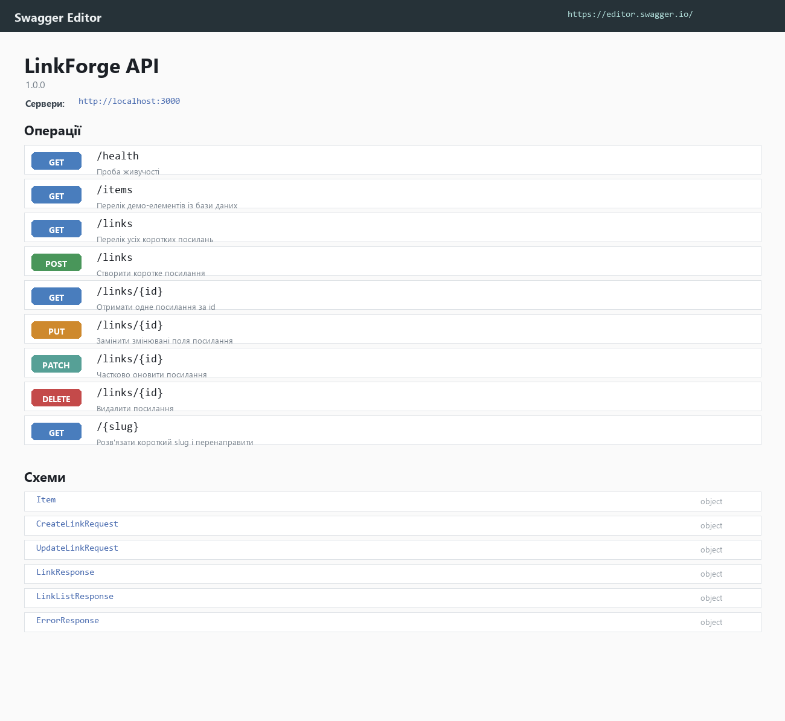

# LinkForge — скорочувач URL

Невеликий самодостатній скорочувач URL, який реалізує **лабораторні 1–5** курсу:
браузерний клієнт звертається до бекенду на Express, який зберігає дані в SQLite;
проєкт задокументований (бізнес-документ, roadmap, DDD, ADR, OpenAPI), а клієнт
захищений ретраями, таймаутами та режимом деградації.

Увесь застосунок — це **модульний моноліт**: `api/ → service/ → domain/` з тонким
шаром `infra/` для наскрізних задач. Без етапу збірки — звичайні ES-модулі.

## Стек

| Задача        | Вибір                                                         |
|---------------|---------------------------------------------------------------|
| Середовище    | Node.js 22.5+ (використовує вбудований модуль `node:sqlite`)  |
| Бекенд        | Express 4 + cors                                              |
| База даних    | SQLite (файл `data/app.db`, створюється й наповнюється сам)   |
| Клієнт        | Чистий HTML/CSS/JS, який віддає Express (`public/`)           |
| Тести         | Вбудований раннер `node:test`                                 |
| Контракт API  | OpenAPI 3.0.3 (`docs/api/openapi.yaml`)                       |

## Швидкий старт

```bash
npm install
npm start
# відкрити http://localhost:3000
```

Розробка з автоперезапуском:

```bash
npm run dev
```

Запуск юніт-тестів:

```bash
npm test
```

Змінні середовища (усі необов'язкові):

| Змінна           | За замовчуванням        | Значення                                 |
|------------------|-------------------------|------------------------------------------|
| `PORT`           | `3000`                  | HTTP-порт                                |
| `BASE_URL`       | `http://localhost:PORT` | Префікс для побудови `shortUrl`          |
| `DB_PATH`        | `data/app.db`           | Файл SQLite (можна `:memory:`)           |
| `RATE_MAX`       | `30`                    | Максимум запитів на вікно на IP          |
| `RATE_WINDOW_MS` | `10000`                 | Вікно rate-limit у мілісекундах          |
| `CHAOS`          | `0`                     | `1` — глобально інжектити збої           |

## Структура проєкту

```
url-shortener/
├── server.js                 # точка входу: створює БД + застосунок, слухає порт
├── src/
│   ├── app.js                # збирає middleware, роутери, статику
│   ├── api/                  # HTTP-шар: маршрути -> DTO -> відповіді
│   │   ├── links.routes.js
│   │   ├── items.routes.js
│   │   ├── health.routes.js
│   │   └── redirect.routes.js
│   ├── service/              # сценарії: валідація, оркестрація
│   │   ├── link.service.js
│   │   └── item.service.js
│   ├── domain/               # сутності + інваріанти + помилки
│   │   ├── Link.js
│   │   ├── Item.js
│   │   └── errors.js
│   └── infra/                # БД, request-id, rate-limit, chaos, помилки
├── public/                   # клієнт: index.html, app.js, styles.css
├── tests/                    # юніт-тести рівня service/
└── docs/                     # усі артефакти лабораторних (див. нижче)
```

## Документація API

Машинозчитуваний контракт — [`docs/api/openapi.yaml`](docs/api/openapi.yaml).
Його перевірено в Swagger Editor; відрендерений результат збережено як
[`docs/api/swagger_screenshot.png`](docs/api/swagger_screenshot.png):



### Ендпоїнти

| Метод  | Шлях            | Успіх   | Помилки                    | Примітки                            |
|--------|-----------------|---------|----------------------------|-------------------------------------|
| GET    | `/health`       | 200     | —                          | `{ "status": "ok" }`                |
| GET    | `/items`        | 200     | 429                        | Демо-список лаб. 1 зі SQLite        |
| GET    | `/links`        | 200     | 429, 503                   | `{ items: [...] }`                  |
| POST   | `/links`        | 201     | 400, 409, 429, 503         | Ідемпотентний з `Idempotency-Key`   |
| GET    | `/links/{id}`   | 200     | 404, 429                   | Один лінк                           |
| PUT    | `/links/{id}`   | 200     | 400, 404, 429              | Оновлення змінюваних полів          |
| PATCH  | `/links/{id}`   | 200     | 400, 404, 429              | Часткове оновлення                  |
| DELETE | `/links/{id}`   | 204     | 404, 429                   | Видалення                           |
| GET    | `/{slug}`       | 302     | 404                        | Редірект на оригінальний URL        |

Кожна відповідь містить заголовок **`X-Request-Id`**. Тіло помилки має єдину
форму:

```json
{ "error": "ValidationError", "code": "ORIGINAL_URL_REQUIRED",
  "details": [{ "field": "originalUrl", "message": "originalUrl is required" }],
  "requestId": "8f14e45f-..." }
```

### Ідемпотентне створення

Надішліть той самий `Idempotency-Key` двічі — отримаєте той самий ресурс:

```bash
IDEM=$(uuidgen)
curl -i -X POST localhost:3000/links \
  -H "Content-Type: application/json" \
  -H "Idempotency-Key: $IDEM" \
  -d '{"originalUrl":"https://example.com/a/long/path"}'
# повторіть із тим самим $IDEM -> ідентичний "id" у відповіді
```

## Стійкість (лаб. 5)

- **Ідемпотентність** — `POST /links` повертає збережений результат для відомого ключа.
- **Кореляція** — `X-Request-Id` у кожній відповіді, дублюється як `requestId` у помилках.
- **Rate limit** — фіксоване вікно на IP; `429` містить `Retry-After`.
- **Ретраї клієнта** — експоненційний backoff + джитер для `5xx`/мережевих збоїв.
- **Таймаут клієнта** — `AbortController` перериває повільні запити.
- **Режим деградації** — після 3 послідовних збоїв UI показує банер і тимчасово
  вимикає кнопки.
- **Перемикач chaos** — чекбокс «Chaos mode» надсилає `X-Chaos: 1`, щоб інжектити
  затримки, `503` і `429` для демонстрації шляхів стійкості.

## Лабораторні → артефакти

| Лаб. | Що потрібно                                        | Де лежить |
|------|----------------------------------------------------|-----------|
| 1    | Клієнт → бекенд → БД, `GET /items`, таблиця items  | `public/`, `src/api/items.routes.js`, `src/infra/db.js` |
| 2    | Бізнес-документ, діаграма архітектури, roadmap     | `docs/business_doc.md`, `docs/architecture_diagram.png`, `docs/roadmap.md` |
| 3    | DDD: сутності, глосарій, контекстна карта, код     | `docs/domain/`, `src/domain/` |
| 4    | Рішення про архітектуру, OpenAPI, CRUD, ADR, тести | `docs/adr/`, `docs/api/openapi.yaml`, `src/api/`, `tests/` |
| 5    | Ідемпотентність, ретраї, таймаути, деградація      | `src/infra/`, `public/app.js`, `src/api/links.routes.js` |

Детальні звіти (≈100 рядків кожен) — у [`docs/reports/`](docs/reports/).

## Ліцензія

MIT.
